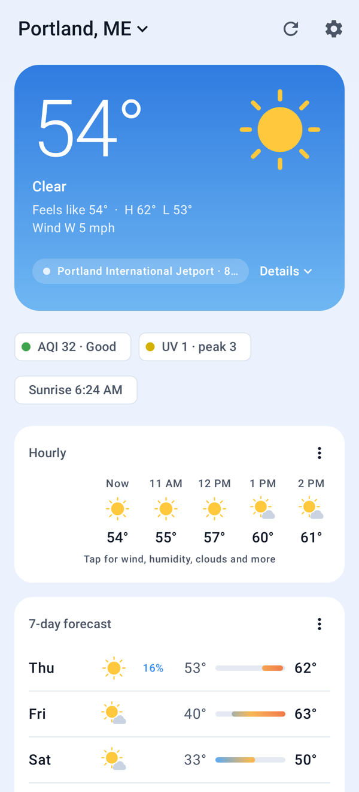
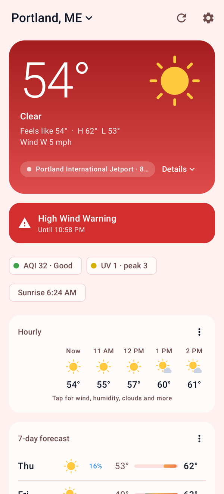
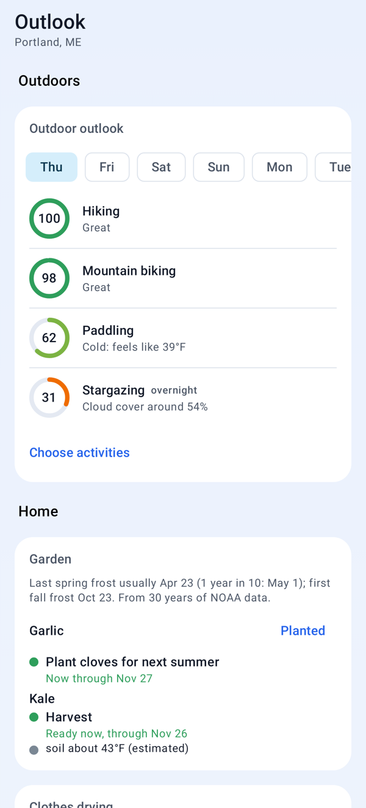
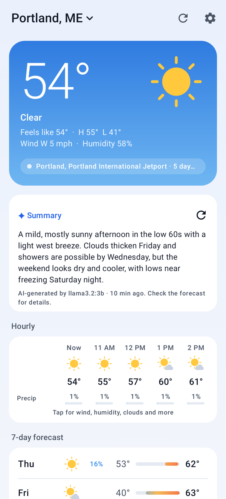
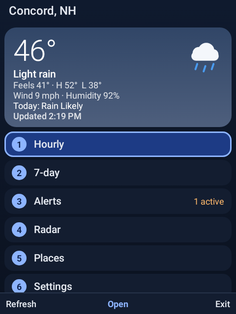
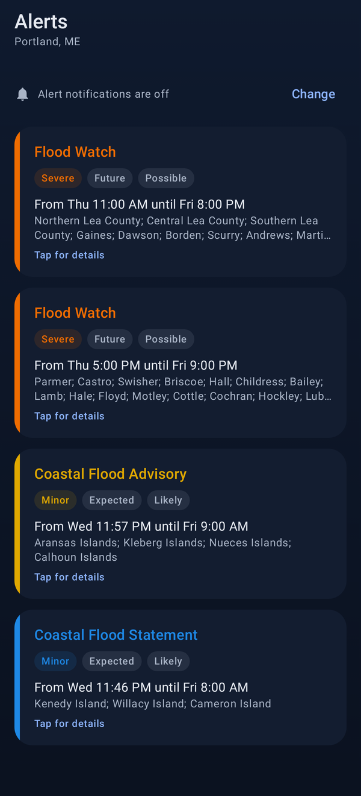
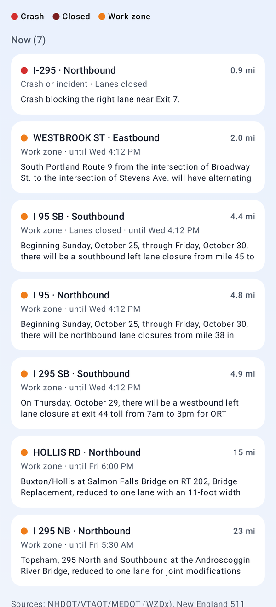
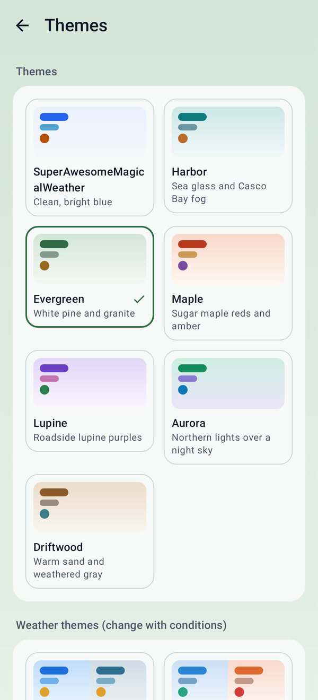
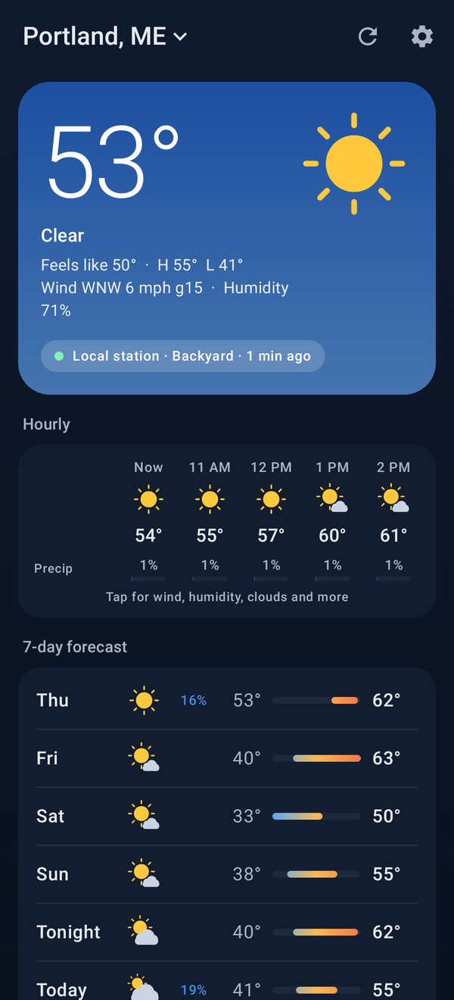

# SuperAwesomeMagicalWeather

[](https://github.com/603Madison/SuperAwesomeMagicalWeather/actions/workflows/ci.yml)
[](LICENSE)
[](https://github.com/603Madison/SuperAwesomeMagicalWeather/releases/latest)

A private, ad-free weather app for Android, built on free NOAA and National
Weather Service data. No accounts, no analytics, no built-in API keys.

<p>




</p>

- **Forecasts with real numbers**: hourly and 7-day, with gusts, rain and snow
  amounts, humidity, cloud cover and thunder chance.
- **Radar with a future cast** from NOAA's HRRR model, adjusted to match the
  latest radar.
- **Severe weather alerts** in the background for every saved place.
- **Your own WeeWX station** can supply current conditions.
- **Backwoods mode** keeps working on satellite links such as T-Mobile
  T-Satellite, and while Android's Data Saver is on.
- **Planning tools** for New England life: power outages, frozen pipes, black
  ice, aurora, garden, heating, maple sap, burn days and more.
- **US and Canada**: NWS for the US, Environment Canada for Canada.

## Install

1. **[Download the latest APK](https://github.com/603Madison/SuperAwesomeMagicalWeather/releases/latest)**
   on your phone (older versions are under [all releases](https://github.com/603Madison/SuperAwesomeMagicalWeather/releases)).
2. Open it and allow installs from your browser or file manager when asked.
3. Optional: check the file against `SHA256SUMS.txt` on the release page.

Needs Android 8.0 or newer. The satellite features need Android 16+ and a
carrier with satellite data.

**Or get updates through F-Droid**: add the app's own repository with this
[one-tap link](https://fdroid.link/#https://603madison.github.io/SuperAwesomeMagicalWeather/repo?fingerprint=959FA8D3634E3CF7409BA1D5BD1C438FD68B9FC169C47E429E16800FD076DBBF),
or in F-Droid under Settings › Repositories with the address
`https://603madison.github.io/SuperAwesomeMagicalWeather/repo` and fingerprint
`959FA8D3634E3CF7409BA1D5BD1C438FD68B9FC169C47E429E16800FD076DBBF`. It has the
same signed APKs as the GitHub releases, so you can switch between the two. See
[docs/FDROID.md](docs/FDROID.md).

> **Formerly Northvane.** The app was renamed in 1.7.0. It installs as an
> update over Northvane, and your places and settings carry over. Downloads up
> to 1.6.2 are named `Northvane-…apk`.

### SuperAwesomeMagicalWeather Mini, for flip phones



Each release also has **SuperAwesomeMagicalWeather-Mini**, a separate small app
for Android flip phones such as the Kyocera DuraXV, Sonim XP3plus, TCL Flip and
CAT S22 Flip. It installs alongside the main app.

- **Works entirely from the keypad**, touchscreen or not: ▲▼ to move, OK to
  select, the soft keys for the actions shown at the bottom.
- **Number shortcuts** on the home screen: 1 Hourly, 2 7-day, 3 Alerts,
  4 Radar, 5 Places, 6 Settings, 7 Read aloud, 0 Keys & help.
- **Morning briefing** as a notification at the time you pick, and **Read
  aloud** (key 7) speaks it with the phone's own voice.
- Current conditions, 48 hours, 7 days, alerts with notifications, several
  places (search by town or ZIP, or use GPS), °F/°C, light and dark themes.
- **Radar** as one map picture per frame: ◀▶ steps through time, `*` `#` zoom,
  2 4 6 8 pan, OK plays.
- **Light on data and memory**: about 25 KB per forecast refresh and 60 KB per
  radar frame, so it suits Android Go phones.

<br clear="right">

## Features

Each card can be turned on or off in Settings. The last column is the default.

### Today screen

| Feature | What it shows | Default |
|---|---|---|
| **Current conditions** | From your WeeWX station if one is nearby, otherwise the nearest NWS observation | On |
| **Hourly** | Temperature and rain chance at a glance; tap for wind, gusts, humidity, dew point and clouds over 36 hours | On |
| **7-day** | Tap a day for wind, rain and snow totals, humidity, cloud cover and thunder chance | On |
| **Sun** | The sun's path, time to sunset or sunrise, and day length | On |
| **Air quality** | AQI with a 4-day outlook, from EPA AirNow (free key) or Open-Meteo | On |
| **UV index** | Today's peak and an hourly chart, from the EPA | On |
| **Allergy score** | A personal daily score from your allergens, pollen, mold and air quality | On |
| **Pollen** | Tree, grass and weed pollen by plant, from Google's Pollen API (your key) | Off |
| **Aurora** | Shows up only when the northern lights may be visible from where you are, with optional notifications | On |
| **Power outage risk** | A daily risk level for New England's tree-lined power lines, with prep steps when it's high | Off |
| **Frozen pipes** | Risk on nights at or below 20°F, with steps to protect your pipes | Off |
| **Black ice & frost** | Mornings with frost on windshields or black ice on the roads | Off |
| **Storm totals** | When a big storm is coming: snow, ice and rain totals, its timing and heaviest hours | Off |
| **Wildfire smoke** | Shows up only when smoke is forecast: how smoky, when, and what to do (NOAA HRRR) | Off |
| **AI summary** | A 2–4 sentence briefing from your own AI server (Ollama, Open WebUI, LibreChat or any OpenAI-compatible server) | Off |

When an NWS **warning** is in effect, the Today screen turns red.

### Outlook tab

Planning cards, each shown only when it's in season.

| Feature | What it shows | Default |
|---|---|---|
| **Outdoor activities** | Daily 0–100 scores with tips for hiking, camping, biking, paddling and stargazing, plus seasonal ones like skiing, ice fishing, swimming and hunting | On |
| **Fall foliage** | Estimated color stage and peak for your spot | On |
| **Trail mud** | A daily mud level, including spring mud season | Off |
| **Clothes drying** | The best line-drying window, and a "my laundry is out" rain watch | Off |
| **Garden** | Planting and harvest dates from your local frost dates, frost warnings and watering advice | Off |
| **Heating** | Which heat source to run each day, and chores like buying oil or stacking wood | Off |
| **Maple sap** | Which days the sap will run, mid-January to April | Off |
| **Burn days** | Good, caution or don't-burn days for brush piles | Off |
| **Rivers & tides** | The nearest river gauge (flow, height, water temperature, rising or falling) and tide times; water temperature and rising rivers also feed the paddling score | Off |

### Radar

- The **past hour** from NOAA's official radar mosaic (or the IEM NEXRAD
  composite), on a free OpenStreetMap basemap.
- A **future cast** for the next few hours from NOAA's HRRR weather model,
  adjusted to match the latest radar. The first frames carry the latest radar
  along its own motion and hand over to the model by two hours, so rain doesn't
  jump or vanish where the forecast begins.
- Optional **satellite imagery** under the radar: visible by day, infrared at night.

### Alerts

- Background checks every 15, 30 or 60 minutes for the places you choose.
- Separate notification channels for **warnings**, **watches**, **advisories**
  and **statements**. An updated alert replaces its old notification, and
  notifications go away when the alert ends.
- **Send test notification** shows exactly how a warning will look and sound.

### Notifications and widget

| Feature | What it does | Default |
|---|---|---|
| **Morning briefing** | Today's forecast in a few sentences, once a day at the time you pick | Off |
| **Rain starting soon** | A heads-up up to an hour before rain or snow starts, from a 15-minute forecast (never 10 PM–6 AM) | Off |
| **Home-screen widget** | Temperature, conditions, high and low and the next rain for the place on your Today screen, on its sky colors | Add it from your home screen |

### Traffic tab

Work zones from state DOT feeds, crashes and closures from New England 511, and
optional live speeds from TomTom (your own free key), on a map and in a list
sorted by distance.

### Backwoods mode

Backwoods mode saves data. It turns on by itself on a satellite connection, or
on mobile data while Android's **Data Saver** is on (even if the app is set to
"Unrestricted data"). You choose what it may still download, with the size of
each item shown. Cards whose data is more than 12 hours old are hidden until
you're back on a normal connection.

### Themes

Seven built-in themes, two that change with the weather (**Live sky** and
**Temperature**), and **Custom** with your own colors or photo. Light, dark or
follow the system, and °F or °C.

<p>




</p>

## Optional keys and servers

None of these are needed. Set them up in **Settings › Data sources**; keys are
stored encrypted on the phone.

| Service | What it adds | Cost |
|---|---|---|
| [WeeWX](weewx/README.md) station | Your own current conditions for places near it | Free (your station) |
| Google Pollen API | Pollen by plant | Free for typical use: 5,000 requests a month free, and the app uses about 124 per place |
| EPA AirNow | Official air quality forecasts | Free key |
| New England 511 | Crashes and closures | Free key |
| TomTom | Live traffic speeds | Free tier |
| OpenWeatherMap | A fallback where NWS and Environment Canada don't reach | Free tier |
| Your AI server | The AI summary | Your own server |

## Privacy

- No accounts, ads or analytics, and no API keys built into the app.
- Your location goes only to the weather services that need it. The aurora
  forecast doesn't use it at all.
- Plain HTTP is allowed only for servers on your home network, and passwords
  and keys are never sent over it.

See [docs/SECURITY.md](docs/SECURITY.md) for the full security and privacy
design, and [SECURITY.md](SECURITY.md) to report a vulnerability.

## More documentation

- [How it works](docs/HOW-IT-WORKS.md): data sources, the future cast, and how
  each estimate is made.
- [WeeWX setup](weewx/README.md): connect your own weather station.
- [Changelog](CHANGELOG.md): what's new in each release.
- [Contributing](CONTRIBUTING.md), [Releasing](docs/RELEASING.md) and [F-Droid](docs/FDROID.md).

## Building

You need Android Studio with AGP 9.4 support, JDK 17+ and Android SDK
platform 37.

```bash
./gradlew :core:test                    # data layer and security tests
./gradlew :app:testDebugUnitTest        # app tests; renders screenshots to app/build/outputs/screenshots
./gradlew :mini:testDebugUnitTest       # Mini tests, driven by keys only
./gradlew :app:lintDebug :ui:lintDebug :mini:lintDebug
./gradlew :app:assembleDebug :mini:assembleDebug   # installable debug APKs
./gradlew :core:test -Pnorthvane.live=true          # also hit the real NWS, NOAA and IEM services
```

To build signed release APKs, put your key details in a git-ignored
`keystore.properties` next to `settings.gradle.kts`, then run
`./gradlew :app:assembleRelease :mini:assembleRelease`:

```properties
storeFile=/path/to/release.jks
storePassword=…
keyAlias=…
keyPassword=…
```

| Folder | What's in it |
|---|---|
| `core/` | Plain Kotlin, no Android: API clients, parsers, forecast merging, estimates, radar decoding, network security policy |
| `app/` | The Android app: Compose UI, MapLibre radar, background alert checks, encrypted key storage |
| `ui/` | Look and feel shared by both apps: weather icons, sky colors, brand colors |
| `mini/` | The flip-phone app |
| `weewx/` | WeeWX skin and setup guide |
| `docs/` | How it works, security notes, release process, screenshots |

## Data sources and attribution

- Weather, alerts and radar: NOAA / National Weather Service (public domain).
- Canada: Environment and Climate Change Canada (Open Government Licence – Canada).
- Future cast: NOAA HRRR via the NOAA Open Data Dissemination program on AWS
  (public domain). Fallback HRRR tiles and the NEXRAD composite: Iowa
  Environmental Mesonet, Iowa State University.
- Recent observed weather: NOAA Regional Climate Centers, ACIS (public domain).
- Aurora: NOAA Space Weather Prediction Center (public domain).
- UV and AirNow air quality: US EPA. Air quality model and the 15-minute precipitation forecast: Open-Meteo (CC BY 4.0).
- Wildfire smoke: NOAA HRRR smoke model via NOAA Open Data on AWS (public domain).
- Rivers: USGS Water Data (public domain). Tides and coastal water temperature: NOAA Tides & Currents (public domain).
- Satellite imagery: NOAA nowCOAST (GOES-East/West).
- Work zones: state DOT WZDx feeds via the USDOT registry. Incidents: New England 511.
- Basemap: OpenFreeMap; © OpenMapTiles; © OpenStreetMap contributors.
- Optional, with your own keys: Google Pollen API, TomTom, OpenWeatherMap.
- Activity, mud, foliage, outage, frozen pipe, ice, aurora, sap and burn
  outlooks are the app's own estimates, not official forecasts.

## License

Free software under the **GNU General Public License v3.0 or later**, with no
warranty. See [LICENSE](LICENSE). Weather data and map tiles remain under their
providers' own terms.

Copyright © 2026 SuperAwesomeMagicalWeather contributors. SPDX-License-Identifier: `GPL-3.0-or-later`.
