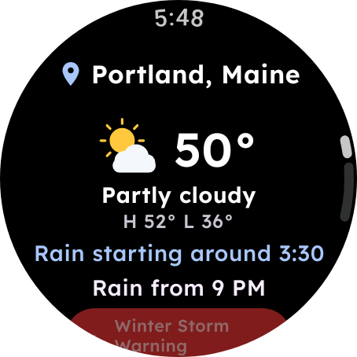

# SuperAwesomeMagicalWeather for Wear OS



A small weather app for watches with Wear OS 3 or newer (Samsung Galaxy Watch 4
and later, Pixel Watch, recent Fossil, Mobvoi and others). It downloads its own
forecasts, so it needs no phone app and no Google Play services.

- Temperature, conditions, today's high and low, and the same one-line headline
  as the phone apps.
- Next-hour rain: "Rain starting around 3:40" or "Dry for the next hour".
- Alerts for the place, with notifications for new ones. Tap an alert to read it.
- The next 12 hours and 7 days. Tap a day for its full forecast.
- Places: **Current location** (the watch's own location service) and places
  found by name or ZIP code, typed or spoken. Tap the place name at the top to
  switch.
- A **tile** and a watch face **complication** (short: the temperature; long:
  the next hour's rain or the headline), refreshed in the background at most
  twice an hour.
- Settings: units, which place the tile shows, next-hour rain, alert
  notifications and background updates.

<br clear="right">

## Installing

Watches have no web browser, so the APK goes on from a computer with `adb`
(Android's platform tools:
[download](https://developer.android.com/tools/releases/platform-tools)).

1. Download `SuperAwesomeMagicalWeather-Wear-vX.Y.Z.apk` from the
   [latest release](https://github.com/603Madison/SuperAwesomeMagicalWeather/releases/latest).
2. On the watch, turn on developer options: open **Settings › System › About**
   (on Galaxy watches **About watch › Software**) and tap **Build number** (or
   **Software version**) seven times.
3. **Settings › Developer options**: turn on **ADB debugging** and **Wireless
   debugging**. The watch and the computer must be on the same Wi-Fi network.
4. Tap **Wireless debugging › Pair new device**. The watch shows an address and
   a pairing code. On the computer:

   ```bash
   adb pair 192.168.1.23:37000     # the address shown under the pairing code; enter the code
   adb connect 192.168.1.23:41000  # the address shown on the Wireless debugging screen
   adb install SuperAwesomeMagicalWeather-Wear-vX.Y.Z.apk
   ```

   On watches that offer **Debug over Wi-Fi** instead of pairing, turn that on
   and run only `adb connect` with the address it shows.
5. Turn wireless debugging off again when you're done; it uses battery.

Updates install the same way: `adb install -r` with the new APK keeps your
places and settings. Every release is signed with the same key as the phone
apps.

## Adding the tile and complication

- **Tile**: swipe left from the watch face to the end of the tiles, tap **+**
  and pick **Weather**.
- **Complication**: long-press the watch face, tap **Customize**, pick a
  complication slot and choose **Weather**. The temperature fits any slot; long
  slots also show the next hour's rain or today's headline.

Both read what the app last downloaded. With **Background updates** on, the
watch refreshes the tile's place every 30 to 60 minutes (only when it has a
connection); turn it off to update only when you open the app.

## Privacy

Your places and settings stay on the watch (no backup or cloud sync). The
watch's position for Current location is read only while the app is open; the
background updates use the last position the app saw. Requests go to the
National Weather Service, Environment and Climate Change Canada and Open-Meteo,
over HTTPS only.
